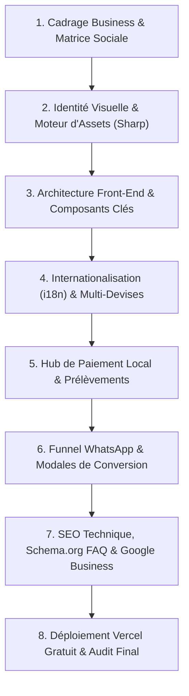

# SOP : Blueprint de Création de Sites Web Haute Conversion (Architecture WhatsApp + Réseaux Sociaux & SEO)

> **Rôle de l'Agent** : Ce document est une **Procédure Opérationnelle Standard (SOP)** autonome. L'agent Antigravity doit suivre cette feuille de route pas-à-pas lors de la création d'un nouveau site web orienté acquisition WhatsApp, multi-devises, multi-langues, écosystème social et SEO local dominant.

---

## SOMMAIRE EXÉCUTIF DU WORKFLOW



---

## PHASE 1 : Cadrage Business & Matrice des Réseaux Sociaux

### 1.1 Fiche d'Identité Entreprise
Avant d'écrire la moindre ligne de code, extraire ou clarifier avec le client :
* **Raison Sociale / Forme Juridique** : (ex: *G&L MOTORS E.A.S.*, LLC, SAS, etc.).
* **Niche & Modèle Économique** : Location de véhicules, e-commerce, artisanat, atelier mécanique, services pro.
* **Emplacement Physique & Géociblage** : Adresse complète, ville, département/région, code postal, coordonnées GPS.
* **Numéro WhatsApp Business** : Format international sans espaces ni signes (ex: `595995620416`).
* **Tarifs Clés & Périodicités** : Prix journalier, hebdomadaire, mensuel, ou panier moyen.

### 1.2 Matrice de Sélection des Réseaux Sociaux selon le Business Model
Ne jamais brancher tous les réseaux aveuglément. Adapter selon la cible :

| Modèle Économique | Cœur de Conversion | Réseaux Prioritaires | Rôle de Chaque Réseau |
| :--- | :--- | :--- | :--- |
| **Location / Service Local** | WhatsApp Direct | **Facebook Page + Google Maps** | Facebook (communauté locale, Marketplace, avis) + Maps (recherche d'urgence). |
| **E-commerce B2C Mode / Déco** | Checkout / Panier | **Instagram + TikTok Shop + Pinterest** | Insta (crédibilité visuelle), TikTok (vidéos produit virales), Pinterest (inspiration d'achat). |
| **Services Pro / B2B** | Appel / Formulaire | **LinkedIn + WhatsApp** | LinkedIn (autorité et réseau B2B), WhatsApp (rapidité de closing). |
| **Food / Restauration** | Commande WhatsApp | **Instagram + Google Maps + TikTok** | Reels culinaires, avis géolocalisés, stories d'offres du jour. |

---

## PHASE 2 : Identité Visuelle & Moteur de Production d'Assets

### 2.1 Charte Graphique Haute Visibilité
* **Couleurs Marketing Contrastées** : Utiliser un fond sombre texturé (carbone `#030F08`) ou un blanc épuré avec des couleurs d'accent vibrantes :
  * Vert néon (`#00E676`) : Gain, WhatsApp, Bolt, Validation.
  * Jaune / Or électrique (`#FFD600`) : Prix imbattable, monnaie, rareté.
  * Orange vif (`#FF6D00`) : Maintenance, avertissement commercial, urgence.
  * Cyan / Émeraude (`#00E5FF` / `#34D186`) : Assistance, sérénité, support.
* **Typographie Unique & Harmonisée** :
  * Imposer **une seule famille de police** sur l'ensemble du projet (ex: `Geist` ou `Inter`).
  * **Règle absolue** : Supprimer toutes les classes perturbatrices comme `font-sans` ou `font-mono` isolées dans le HTML et forcer dans `style.css` :
    ```css
    * { font-family: var(--font-primary, 'Geist', sans-serif) !important; }
    ```

### 2.2 Automatisation des Visuels avec Node.js & Sharp
Pour tous les flyers, bannières et découpages :
* **Détourage & Amélioration** :
  * Accentuer la netteté : `.sharpen({ sigma: 1.2, m1: 1.5, m2: 0.7 })`.
  * Redimensionner avec `fit: 'inside'` pour ne jamais déformer le ratio d'aspect.
* **Piège Technique Évité (Alpha Mask)** : Lors d'un masque circulaire (`dest-in`) sur une image JPEG, toujours forcer `.ensureAlpha()` et `.png()` sinon les coins restent noirs au lieu d'être transparents :
  ```js
  const roundLogo = await sharp(imagePath)
    .ensureAlpha()
    .resize(size, size, { fit: 'cover' })
    .composite([{ input: Buffer.from(`<svg><circle cx="${size/2}" cy="${size/2}" r="${size/2}" fill="#fff"/></svg>`), blend: 'dest-in' }])
    .png()
    .toBuffer();
  ```
* **Bannière Facebook Standard (1640 × 624 px)** :
  * Produire un canvas 1640x624 px respectant la zone de sécurité mobile (640x360 au centre).
  * Afficher le logo de marque, l'image phare détourée sur podium lumineux, 5 à 6 badges bénéfices ultra-lisibles, et le CTA WhatsApp géant.

---

## PHASE 3 : Architecture Front-End & Composants Clés

### 3.1 Stack Recommandée : Vanilla Web Ultra-Rapide
* **Pourquoi pas de framework lourd (Next.js/React)** : Un site statique HTML5 + Tailwind CDN + Vanilla JS charge en < 0.8s, obtient un score Google Core Web Vitals de 98-100/100, et ne nécessite aucun serveur node en production (0€ d'hébergement).

### 3.2 Structure Structurante du HTML (`index.html`)
1. **Header Flottant Adaptatif** :
   * Logo rond avec ombre.
   * Sélecteur de devise (avec drapeau et symbole).
   * Sélecteur de langue (avec drapeau et code).
   * Bouton CTA d'action rapide.
2. **Hero Section** :
   * Arrière-plan vidéo en boucle (avec poster image pour mobile).
   * Titre H1 percutant avec mots-clés d'intention de recherche.
   * Pastille de prix d'appel avec infobulle interactive (`₲50.000/jour`).
   * Double CTA : "Réserver" (modale) et "Voir les tarifs" (scroll ancre).
3. **Catalogue / Flotte de Produits** :
   * Cartes modernes avec image détourée, spécifications en pastilles, bénéfice d'usage ("Vous visez la rentabilité...").
4. **Simulateur de Gains / Rentabilité** (si orienté travail/Bolt/business) :
   * Curseur interactif d'heures travaillées par jour.
   * Calcul en temps réel du chiffre d'affaires brut, des frais d'essence, de la commission et du **Bénéfice NET estimé**.
   * Note de conformité légale (mention légale indicative).
5. **Section Tarifs & Hub de Paiement** (voir Phase 5).
6. **FAQ en Accordéon** (10 à 12 questions calibrées pour le SEO).
7. **Footer Légal & Géolocalisé** :
   * Horaires, adresse, carte Google Maps interactive, boutons Waze, copyright et modale de politiques légales.

---

## PHASE 4 : Moteur d'Internationalisation (i18n) & Multi-Devises

### 4.1 Détection Automatique Intelligente
* **Langue du Visiteur** :
  * Détecter `navigator.languages` ou `navigator.language`.
  * Si la langue du navigateur correspond à l'une des langues supportées, l'activer.
  * **Fallback par défaut** : Toujours initialiser sur la langue du marché cible (ex: Castellano / Espagnol pour le Paraguay).
  * Respecter l'override utilisateur stocké dans `localStorage.getItem("gl_lang_manual")`.
* **Devise du Visiteur** :
  * Analyser le fuseau horaire (`Intl.DateTimeFormat().resolvedOptions().timeZone`) et la langue.
  * **Fallback par défaut** : Toujours initialiser sur la monnaie nationale (ex: `PYG` au Paraguay).
  * Respecter l'override utilisateur stocké dans `localStorage.getItem("gl_currency_manual")`.

### 4.2 Architecture des Fichiers de Traduction (`translations.js`)
* Créer un objet global `TRANSLATIONS = { fr: {...}, es: {...}, castillano: {...}, en: {...} }`.
* **Règle anti-fuite de langue** : Chaque clé présente dans une langue doit impérativement exister dans toutes les autres langues pour éviter qu'un mot reste dans une autre langue.
* **Attribut DOM** : Utiliser des balises déclaratives `data-i18n="cle_de_traduction"` et un injecteur automatique :
  ```js
  document.querySelectorAll("[data-i18n]").forEach(el => {
    const key = el.getAttribute("data-i18n");
    if (TRANSLATIONS[lang]?.[key]) el.innerHTML = TRANSLATIONS[lang][key];
  });
  ```

---

## PHASE 5 : Hub de Paiement Local & Prélèvements Récurrents

### 5.1 Virement Bancaire Instantané Local (ex: SIPAP, PIX, SEPA)
* **Problème fréquent des QR bancaires** : Les QR codes générés par certaines apps mobiles (ex: Banco Mango / Bancard) ont parfois un montant fixe et une date d'expiration unique de quelques minutes.
* **Solution robuste à deux niveaux** :
  1. Afficher l'**Alias officiel ou Clé de virement** (ex: C.I., Téléphone, IBAN) avec un bouton **"Copier" en 1 clic** avec retour visuel immédiat ("Copié !").
  2. Fournir un sélecteur de forfait (Jour / Semaine / Mois) qui recalcule le montant exact à payer et prépare le reçu à expédier par WhatsApp.

### 5.2 Carte Bancaire & Débit Automatique (Récurrent)
* **Fréquences autorisées** : Donner uniquement les choix pertinents (ex: Journalier et Hebdomadaire ; supprimer le mensuel si non désiré par le business).
* **Affichage transparent** :
  * Indiquer la passerelle sécurisée locale officielle (ex: *Pagopar & Bancard vPOS 2.0* ou *Stripe*).
  * Mentionner : "Sans engagement : résiliable à tout moment lors de la restitution".
* **Modale de souscription** : Formulaire fluide avec masque de carte bancaire, expiration, Cédula / DNI du porteur et validation sécurisée.

### 5.3 Paiement Cash / Efectivo & Cripto
* Toujours afficher le Cash avec retrait en agence pour rassurer la clientèle locale non bancarisée.

---

## PHASE 6 : Funnel WhatsApp Haute Conversion

Le bouton WhatsApp ne doit **jamais** ouvrir une discussion vide. Il doit transmettre un bon de commande pré-rempli :

### 6.1 Générateur d'URL WhatsApp Convivial
```js
function buildWhatsAppBookingUrl(data) {
  const text = `¡Hola G&L MOTORS! 🏍️\n\n` +
    `Quisiera reservar una moto:\n` +
    `• Modelo: ${data.bikeName}\n` +
    `• Plan: ${data.planLabel} (${data.priceFormatted})\n` +
    `• Medio de pago: ${data.paymentMethod}\n` +
    `• Fecha: ${data.date}\n` +
    `• Cuenta Bolt: ${data.boltAccount ? "SÍ, la quiero gratis" : "No, gracias"}\n\n` +
    `¿Podrían confirmarme la disponibilidad en su local? ¡Muchas gracias!`;

  return `https://wa.me/${WHATSAPP_NUMBER}?text=${encodeURIComponent(text)}`;
}
```

---

## PHASE 7 : SEO Dominant, Rich Snippets Schema.org & Local Pack

Pour surclasser les concurrents historiques (même ceux disposant de domaines exacts) :

### 7.1 Balises On-Page Chirurgicales
* **`<title>`** : Placer le mot-clé principal et les villes cibles au début :
  * *Exemple* : `Alquiler de Motos en Asunción & Areguá, Paraguay — G&L MOTORS 150cc`
* **Meta Description** : 155 caractères avec appel à l'action, prix plancher et réassurance (*depuis 50.000 Gs/jour, compte Bolt gratuit, assistance 7/7*).
* **Méta Géographiques** :
  ```html
  <meta name="geo.region" content="PY-11" />
  <meta name="geo.placename" content="Areguá, Central, Paraguay" />
  <meta name="geo.position" content="-25.302387;-57.403957" />
  <meta name="ICBM" content="-25.302387, -57.403957" />
  ```

### 7.2 Données Structurées Google Schema.org (`@graph`)
Intégrer dans le `<head>` un bloc JSON-LD combinant :
1. **`AutoRental` / `LocalBusiness` / `Store`** : Raison sociale, téléphone international, adresse physique, coordonnées géographiques, devises acceptées, horaires d'ouverture et profils sociaux (`sameAs`).
2. **`FAQPage` (Arme secrète SEO)** :
   * Lister les 10 questions/réponses les plus recherchées par les clients.
   * **Impact Google** : Provoque l'affichage d'un accordéon directement sous votre résultat dans Google Search (occupe 3x plus d'espace sur mobile et capte tous les clics).

### 7.3 Fichiers d'Indexation Essentiels
* **`robots.txt`** : Autoriser l'indexation de tous les agents (`User-agent: *`, `Allow: /`) et déclarer l'URL du sitemap.
* **`sitemap.xml`** : Baliser l'URL racine avec les déclinaisons `xhtml:link rel="alternate"` pour toutes les langues supportées et référencer les images clés.

### 7.4 Fiche Google Business Profile (Google Maps)
Fournir systématiquement au client une fiche prête à copier-coller comprenant :
* Nom optimisé pour la recherche locale (ex: `G&L MOTORS - Alquiler y Taller de Motos`).
* Catégorie principale et catégories secondaires exactes.
* Description pré-rédigée incluant les mots-clés d'intention de recherche.
* Pack de photos : Logo rond, bannière Facebook HD, photos des modèles détourées.

---

## PHASE 8 : Déploiement Vercel Gratuit & Audit Final

### 8.1 Déploiement Continu Git
* Configurer le dépôt Git sur GitHub (`master`).
* Lier le dépôt à un projet Vercel. Chaque commande `git push origin master` déclenche un déploiement instantané avec certificat HTTPS SSL automatique.

### 8.2 Renommage Gratuit du Projet Vercel
Guider le client pour personnaliser son URL sans payer de domaine payant :
1. Aller sur le tableau de bord Vercel > Projet > **Settings** > **General**.
2. Modifier le champ **Project Name** vers le nom souhaité (ex: `glmotors` ou `glmotors-py`).
3. Vercel met à jour immédiatement le lien gratuit en `https://glmotors.vercel.app`.

---

## PHASE 9 : Checklist de Vérification "Zéro Défaut" (Agent Review)

Avant de déclarer le site terminé, l'agent doit valider chaque case de ce contrôle :

- [ ] **Uniformité Typographique** : Aucune police différente dans les conteneurs de paiement, simulateur ou modales.
- [ ] **Détection de Langue & Monnaie** : Le site s'ouvre dans la langue et monnaie locale lors d'une première visite vierge (cache nettoyé).
- [ ] **Étanchéité des Traductions** : Aucun mot en français visible lors de la navigation en espagnol ou anglais.
- [ ] **JSON-LD Schema Valide** : Le JSON-LD est parsé sans erreur via `node -e "JSON.parse(...)"` et validé au Rich Results Test.
- [ ] **Boutons WhatsApp Opérationnels** : Chaque bouton de réservation génère un message encodé complet et lisible.
- [ ] **Bannière Sociale Téléversable** : Dimensions 1640x624 px, texte net, logo détouré en cercle sans bavure.
- [ ] **Fichiers SEO Présents** : `robots.txt` et `sitemap.xml` accessibles à la racine.
